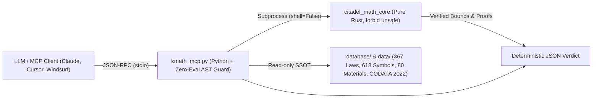
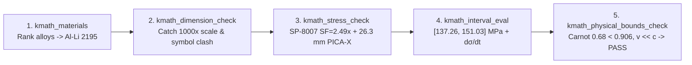

<!-- mcp-name: io.github.imza464-cmyk/citadel-math -->
# Citadel-Math (`citadel_math_core` / `kmath-mcp`)

[](https://github.com/imza464-cmyk/citadel-math/actions/workflows/ci.yml)
[](https://imza464-cmyk.github.io/citadel-math/)
[](https://github.com/imza464-cmyk/citadel-math/releases)
[](./LICENSE)
[](./citadel_math_core/src/lib.rs)
[](./kmath_mcp.py)
[](https://m8ven.ai/mcp/imza464-cmyk-citadel-math-z9zqty?s=readme)

**$\mathbb{Z}^7$ Dimensional Analysis Shield, Checked-`i64` Algebraic Equivalence Checker, and Interval/Physics Verification Engine (Pure-Rust Core + Python/SymPy MCP Server).**  
*$\mathbb{Z}^7$ Boyut Analizi Kalkanı, Taşma Korumalı `i64` Cebirsel Eşdeğerlik Denetleyicisi ve Aralık/Fizik Doğrulama Motoru (Saf-Rust Çekirdek + Python/SymPy MCP Sunucusu).*

---

## What It Catches in ~5 ms (Before / After)



| Failure Mode | Without Citadel-Math (LLM Alone) | With Citadel-Math (`kmath-mcp`, ~5 ms offline) |
| :--- | :--- | :--- |
| **1000× SI Scale Bug** (`kN` vs `kg·m/s²`) | *"Dimensions match — both are force!"* (silent 1000× Mars-Climate-Orbiter bug) | Flags `DIMENSIONALLY_HOMOGENEOUS_BUT_UNIT_SCALE_MISMATCH` (`scale_ratio: 1000.0`) |
| **Dropped Singularity** (`(x²-1)/(x-1) == x+1`) | *"Yes, identically equal."* (panics / divides by zero at `x = 1`) | Rejects unconditional equality; emits required domain guard **`x != 1`** |
| **Floating-Point Drift** (`P·r/t` tolerances & `1000^(2+5e-13)`) | Returns a single optimistic `f64` midpoint that hides rounding & worst-case margins | Returns IEEE 1788-2015 outward-rounded enclosure (`0/1-ULP` tightest, verified by **25,000+ exact `BigInt` dyadic** + **80-digit `Decimal`** oracles) |
| **Dimensionless Factor Bug** (`4·f_darcy·L/D` vs `f_darcy·L/D`) | Passes dimensional checks (since `4` is dimensionless) and leaks a 400% error | Blocked by **367/367 golden numerical anchors**, **1,031 `Dual64` Jacobian checks**, and **25 cross-law closures** |
| **Prompt Injection via Math Input** (`__import__('os')...`) | `sympy.sympify()` executes arbitrary Python via `eval()` | Zero-`eval` AST whitelist blocks **11/11** RCE vectors (`0` `eval()` / `sympify()` calls) |

---

## Why Citadel-Math? / Neden Citadel-Math?

Large Language Models hallucinate units, drop denominator domain guards, confuse classical/relativistic regimes, and leak IEEE-754 rounding errors into engineering safety factors.  
**Citadel-Math (`kmath-mcp`)** pairs a **pure-Rust (`#![forbid(unsafe_code)]`) numerical and algebraic core (`citadel_math_core`)** with a **Python + SymPy Model Context Protocol server (`kmath_mcp.py`)**, giving AI coding agents (Claude, Cursor, Windsurf, Antigravity) and engineers a deterministic verification layer backed by NIST CODATA 2022 constants, SI dimensional lattice checks, outward-rounded intervals, and a canonical physics equation graph.

Büyük Dil Modelleri (LLM) formül türetirken sıklıkla birim hatası yapar, payda sıfır koşullarını atlar ve kayan nokta yuvarlama hatalarını güvenlik katsayılarına sızdırır. **Citadel-Math**, saf Rust (`#![forbid(unsafe_code)]`) ile yazılmış deterministik hesaplama çekirdeğini (`citadel_math_core`) Python/SymPy tabanlı bir MCP sunucu katmanıyla (`kmath_mcp.py`) birleştirerek yapay zekâ ajanlarına birim, aralık ve cebirsel eşdeğerlik doğrulama araçları sunar.



---

## Who Is Citadel-Math For? / Kimlerin İşine Yarar?

Citadel-Math is positioned as an **offline, deterministic physics, unit, and interval guardrail (MCP)** — not a niche rocket toy. Here are the five concrete groups that get immediate engineering value from it:

| Target Group / Hedef Kitle | Problem It Solves / Çözdüğü Gerçek Sorun | Core Tools / Öne Çıkan Araçlar |
| :--- | :--- | :--- |
| **1. AI Agent & Engineering Copilot Teams**<br>*Yapay Zekâ Ajanı & Mühendislik Copilot Ekipleri* | Stops LLMs (Claude, Cursor, Windsurf, internal agents) from silently leaking unit scale bugs (`kN` vs `N`), dropped singularities (`x != 1`), wrong physical regimes (`v > 0.1c`), or floating-point drift into generated code (~5 ms local check). | `kmath_dimension_check`, `kmath_prove_identity`, `kmath_interval_eval`, `kmath_regime_check`, `kmath_physical_bounds_check` |
| **2. Aerospace, Defense, NewSpace & Student Rocket/UAV Teams**<br>*Havacılık, Savunma & Öğrenci Roket/İHA Takımları (TEKNOFEST / USLI)* | Runs Phase-A conceptual screening in milliseconds before opening heavy FEA/CFD suites: alloy selection, cylindrical shell buckling (NASA SP-8007), ablative PICA-X TPS sizing, RK4 ascent & Pareto trade studies. | `kmath_materials`, `kmath_stress_check`, `kmath_simulate_trajectory`, `kmath_inverse_design`, `kmath_pareto_front` |
| **3. Embedded, Robotics & Autonomous Systems Engineers (Rust/C++)**<br>*Gömülü Sistem, Robotik & Otonom Araç Mühendisleri* | Computes mathematically guaranteed worst-case bounds over sensor/manufacturing tolerances (IEEE 1788-2015 outward-rounded intervals) and generates domain-guarded, zero-panic (`#![forbid(unsafe_code)]`) Rust functions. | `kmath_interval_eval`, `kmath_synthesize`, `kmath_solve_for`, `kmath_constant` |
| **4. Physics / Engineering Researchers & Experimental Labs**<br>*Akademisyenler & Deneysel Araştırma Laboratuvarları* | Derives exact dimensionless similarity groups ($\Pi$-groups like Reynolds, Froude, Taylor-Sedov) from raw variables over exact $\mathbb{Z}^7$ integer nullspace, calibrates scaling constants from lab samples, and extracts exact Pareto knees. | `kmath_buckingham_pi`, `kmath_pareto_front`, `kmath_dimension_check`, `kmath_constant` |
| **5. Air-Gapped & Regulated Enterprises**<br>*Gizlilik Zorunlu / İnternetsiz (Air-Gapped) Kurumlar* | Defense, aerospace, automotive, and energy organizations that cannot send proprietary formulas or designs to cloud solvers (Wolfram/cloud MATLAB). Runs 100% locally inside `--network=none --read-only` Docker with dual **AGPL-3.0 / Commercial** licensing. | Full 15-tool offline Docker / GHCR container (`kmath_audit` 33 gates) |

> **Honest Boundary — Who It Is NOT For / Kimler İçin Değildir?**  
> Citadel-Math is **not** a replacement for certified 3D FEA/CFD production sign-off tools (`ANSYS`, `Abaqus`, `OpenFOAM`, `GMAT`) or interactive formal theorem provers (`Lean 4`, `Coq`, `Mathematica`). It is the fast, deterministic **pre-screening filter and AI safety guardrail** that sits *in front* of them.

---

## Quick Start / Hızlı Kurulum (3 Yol)

Choose the workflow that fits your environment — **Rust is NOT required** if you use pre-built release binaries or Docker.

### Option A — Zero-Build Install via Wheel / `uvx` + Pre-Built Binary (No Rust or Git Required)
1. **Download the self-contained Rust core binary** (embedded SSOT JSONs) from [GitHub Releases](https://github.com/imza464-cmyk/citadel-math/releases/tag/v0.2.2) and verify its SHA-256 checksum against `SHA256SUMS.txt`:
   - Linux x86_64: `citadel_math_core-linux-x86_64` (`chmod +x` and place on `PATH` or point `KMATH_RUST_BIN` to it)
   - Windows x86_64: `citadel_math_core-windows-x86_64.exe` (place on `PATH` or point `KMATH_RUST_BIN` to it)
2. **Install directly from the release wheel (no `git` or Rust needed) or run via [`uvx`](https://docs.astral.sh/uv/):**
   ```bash
   # Fastest direct wheel install (gives you `kmath` and `kmath-mcp` CLI commands)
   pip install https://github.com/imza464-cmyk/citadel-math/releases/download/v0.2.2/kmath_mcp-0.2.2-py3-none-any.whl
   kmath stats && kmath audit && kmath rust audit

   # Or run ephemerally via uvx
   uvx --from https://github.com/imza464-cmyk/citadel-math/releases/download/v0.2.2/kmath_mcp-0.2.2-py3-none-any.whl kmath stats
   KMATH_RUST_BIN=/path/to/citadel_math_core uvx --from https://github.com/imza464-cmyk/citadel-math/releases/download/v0.2.2/kmath_mcp-0.2.2-py3-none-any.whl kmath-mcp
   ```
3. **MCP Client Configuration (`uvx`):**
   ```json
   {
     "mcpServers": {
       "kmath": {
         "command": "uvx",
         "args": ["--from", "https://github.com/imza464-cmyk/citadel-math/releases/download/v0.2.2/kmath_mcp-0.2.2-py3-none-any.whl", "kmath-mcp"],
         "env": {
           "KMATH_RUST_BIN": "/ABSOLUTE/PATH/TO/citadel_math_core",
           "OPENBLAS_NUM_THREADS": "1",
           "PYTHONUNBUFFERED": "1"
         }
       }
     }
   }
   ```

### Option B — Hardened Docker Container (Zero Host Rust/Python Dependencies)
Pre-built multi-stage images are published automatically to **GitHub Container Registry (GHCR)** (`ghcr.io/imza464-cmyk/citadel-math`), compiled from [`Dockerfile`](./Dockerfile) and verified under all 33 audit gates as **non-root UID `10001`** with a Python-native `HEALTHCHECK` and exec-form `ENTRYPOINT`.
```bash
# Run directly from GHCR with zero local build (read-only rootfs, zero capabilities, zero network)
docker run -i --rm \
  --read-only \
  --tmpfs /tmp:size=64M,noexec,nosuid \
  --cap-drop=ALL \
  --security-opt=no-new-privileges:true \
  --pids-limit=128 \
  --memory=512m \
  --network=none \
  ghcr.io/imza464-cmyk/citadel-math:0.2.2

# Or build locally from source
docker build -t citadel-math:0.2.2 .
```
See [`docker-compose.yml`](./docker-compose.yml) for the declarative hardened service definition. To attach Docker directly in Claude Desktop / Cursor:
```json
{
  "mcpServers": {
    "kmath": {
      "command": "docker",
      "args": [
        "run", "-i", "--rm", "--read-only",
        "--tmpfs", "/tmp:size=64M,noexec,nosuid",
        "--cap-drop=ALL",
        "--security-opt=no-new-privileges:true",
        "--network=none",
        "ghcr.io/imza464-cmyk/citadel-math:0.2.2"
      ]
    }
  }
}
```

### Option C — Build From Source (Developers & Contributors)
```bash
git clone https://github.com/imza464-cmyk/citadel-math.git
cd citadel-math

# 1. Test & build release Rust core
cargo test --manifest-path citadel_math_core/Cargo.toml
cargo build --release --manifest-path citadel_math_core/Cargo.toml

# 2. Install editable Python package & console scripts (`kmath`, `kmath-mcp`)
pip install -e .

# 3. Verify all 26 audit gates + MCP security tests
kmath audit
kmath rust audit
python -m unittest discover -s tests -v
```
Copy [`mcp_config.example.json`](./mcp_config.example.json) into your MCP client config and set `/ABSOLUTE/PATH/TO/citadel-math/kmath_mcp.py` (the Rust binary in `citadel_math_core/target/release/` is discovered automatically).

---

## End-to-End Chained Agent Scenario / Uçtan Uca 5 Adımlı Ajan Senaryosu

**Prompt to AI Agent:** *"Design and audit a Phase-A cryogenic LOX tank (`45 t` gross mass, `4.5 G`, `q_max = 35 kPa`, `r = 1.8 m`, `L = 14 m`, `t = 5.0 mm`, `P = 4.0 bar`, peak ascent speed `2400 m/s`). Verify alloy selection, unit hygiene, structural buckling + thermal protection, manufacturing-tolerance hoop stress bounds, and propulsion physics."*

Below is the actual deterministic 5-tool chain executed live against `kmath_mcp.py` + `citadel_math_core`:



| Step | MCP Tool Call | Verified Live Output / Caught Failure Mode |
| :---: | :--- | :--- |
| **1** | `kmath_materials(sort_by="yield_strength", category="metal_alloy")` | Compares `mat_maraging_300` (`2000 MPa`, `8000 kg/m³`, `L_b = 25.5 km`), `mat_ss_17_4ph_h900` (`1170 MPa`), `mat_ss_304l_cryo` (`960 MPa`, `806.9 °C`) and selects lightweight cryogenic **`mat_alli_2195`** (`550 MPa` yield, `146.85 °C` max wall limit). |
| **2** | `kmath_dimension_check("kN", "kg * m / s^2")` & `kmath_dimension_check("P * r / t", "Pa")` | **Catches two classic LLM bugs before computing:** (a) flags `1000.0×` scale error (`DIMENSIONALLY_HOMOGENEOUS_BUT_UNIT_SCALE_MISMATCH`), and (b) flags implicit symbol collision where SSOT `P` = Power and `t` = Time (`[M L^3 T^-4] != [M L^-1 T^-2]`), forcing explicit `var_dimensions_json` disambiguation. |
| **3** | `kmath_stress_check("mat_alli_2195", mass_kg=45000, g_load=4.5, max_q_pa=35000, radius_m=1.8, length_m=14.0, wall_thickness_mm=5.0, speed_ms=2400, tank_pressure_bar=4.0)` | **Structural PASS + Auto-TPS Sizing:** Rust Von Mises `130.5 MPa` (`yield_safety_factor = 4.215×`), NASA SP-8007 buckling critical `97.32 MPa` (`buckling_safety_factor = 2.486×`). Bare wall hits `1951.5 °C` (> `146.85 °C` limit) → automatically sizes **`26.32 mm` PICA-X TPS (`173.60 kg`)**, lowering bondline to **`106.85 °C`** (`overall_pass: true`). |
| **4** | `kmath_interval_eval("(P * r) / t", '{"P":[390000,410000],"r":[1.795,1.805],"t":[0.0049,0.0051]}', "t")` | **Guaranteed Tolerance Bounds:** IEEE 1788-2015 outward-rounded hoop stress **`[137.26 MPa, 151.03 MPa]`** (midpoint `144.00 MPa`, width `13.77 MPa`), exact symbolic derivative `-(P * r) / t^2`, sensitivity **`∂σ/∂t = -2.88 × 10¹⁰ Pa/m`** (`-2.88 MPa` per `+0.1 mm` wall thickness). |
| **5** | `kmath_physical_bounds_check(mass_kg=45000, velocity_ms=2400, exhaust_velocity_ms=3400, mass_flow_kg_s=280, thrust_n=952000, temp_hot_k=3200, temp_cold_k=300, efficiency=0.68)` | **Thermodynamic & Causality Seal:** `carnot_max_efficiency = 0.90625` (`0.68 < 0.90625`), `lorentz_gamma = 1.000000000032` (`v ≪ c`), momentum `F = ṁ·v_e = 952 kN` exact → **`physically_realizable: true`**. |

### Additional Standalone Checks / Tekil Canlı Örnekler (All 15 Tools Covered)
- **Domain-Guard Preservation (`kmath_prove_identity`):** `kmath_prove_identity("(x^2 - 1) / (x - 1)", "x + 1")` returns `"proven_identical": false` with `"lhs_domain_guards": ["(x - 1) != 0"]`, rejecting singular cancellation at `x = 1`.
- **Exact Dimensionless Groups (`kmath_buckingham_pi`):** `kmath_buckingham_pi("r,E,rho,t", "r")` derives Taylor-Sedov blast scaling $r \propto (E t^2 / \rho)^{1/5}$ over exact `i128` rational $\mathbb{Z}^7$ nullspace.
- **NIST CODATA & IAU Constants (`kmath_constant`):** `kmath_constant("c")` returns exact `299792458.0 m s^-1`; `kmath_constant("mu_earth")` returns IAU `GM` (`3.986004418e14 m^3 s^-2`).
- **Symbolic Inversion + Safe Rust Codegen (`kmath_solve_for`):** `kmath_solve_for("delta_v = (g_0 * I_sp) * ln(m_0 / m_f)", "m_0")` solves `m_0 = m_f * exp(delta_v / (g_0 * I_sp))` with domain guards and zero-panic Rust code.
- **AND-OR Hypergraph Synthesis (`kmath_synthesize`):** `kmath_synthesize("delta_v,g_0,I_sp,m_f", "m_0", max_depth=3)` chains canonical SSOT laws to synthesize dimensional-verified candidate formulas.
- **RK4 Trajectory Simulation (`kmath_simulate_trajectory`):** `kmath_simulate_trajectory("beamed")` integrates 2D USSA-1976 atmospheric ascent, Max-Q, and orbital perigee/apogee.
- **Closed-Loop Pareto Sizing (`kmath_inverse_design` & `kmath_pareto_front`):** `kmath_inverse_design(payload_kg=500, target_orbit_km=200, max_g_limit=8.5, min_safety_factor=1.35)` sweeps 6,912 configurations; `kmath_pareto_front(...)` extracts exact Rank-0 Skyline and Utopia knee points.
- **Regime Guard & 33-Gate Self-Audit (`kmath_regime_check` & `kmath_audit`):** `kmath_regime_check("law_prandtl_glauert_subsonic_cp", '{"Mach": 0.55, "C_p0": -0.4}')` verifies subsonic validity; `kmath_audit()` runs all 13 Python + 20 Rust epistemic/proof gates.
- **Runnable Offline Scripts (`examples/`):** Run `python examples/quickstart_all_15_tools.py`, `python examples/aerospace_tank_guardrail.py`, or `cargo run --manifest-path citadel_math_core/Cargo.toml --example interval_and_proof`.

---

## Performance & Memory Benchmarks / Performans ve Bellek Kıyaslamaları

Measured live on **Windows 11 x86_64** (Python 3.14, `OPENBLAS_NUM_THREADS=1`, release `citadel_math_core.exe` = **`1.45 MB`**):

| Operation / MCP Tool | Execution Path | `p50` Latency | `p95` Latency | Notes |
| :--- | :--- | :---: | :---: | :--- |
| Server cold start (`import kmath_mcp`) | Python (SymPy + NetworkX + MCP) | `876.3 ms` | — | One-time startup; `109.95 MB` working set (`97.18 MB` private) |
| `kmath_constant("c")` | In-process Python JSON | `0.28 ms` | `0.33 ms` | CODATA 2022 lookup |
| `kmath_dimension_check("kN", "kg * m / s^2")` | In-process Zero-Eval AST | `3.60 ms` | `4.81 ms` | Symbolic AST + $\mathbb{Z}^7$ scale check |
| `kmath_prove_identity` | Python → Rust subprocess (`shell=False`) | `5.30 ms` | `5.68 ms` | Includes full OS process spawn + JSON IPC |
| `kmath_interval_eval` | Python → Rust subprocess (`shell=False`) | `5.45 ms` | `5.72 ms` | IEEE 1788-2015 `Interval64` + `Dual64` |
| `kmath_stress_check` | Python + Rust subprocess | `5.56 ms` | `5.84 ms` | Von Mises + NASA SP-8007 + PICA-X TPS |
| `kmath_audit` (26 gates total) | 10 Python + 16 Rust gates | `45.65 ms` | `47.73 ms` | Native Rust 16-gate audit alone: `~13–17 ms` |

- **Steady-State Memory Footprint:** After running all tools and a full 26-gate audit, the MCP server stabilizes at **`113.16 MB` working set** (`113.21 MB` peak, `100.88 MB` private — only **`+3.2 MB`** delta above initial import).
- **Why Ephemeral Subprocess Isolation?** Each Rust tool call adds `~5.3–5.6 ms` of OS spawn/pipe overhead on Windows (`~1–2 ms` on Linux) in exchange for `shell=False` command-injection immunity, zero persistent FFI memory leaks, and clean timeout isolation (`20 s` hard cap).

---

## Core Architecture / Temel Mimari

```text
.
├── .github/
│   ├── ISSUE_TEMPLATE/             # Bug report & mathematical/physical soundness issue templates
│   └── workflows/
│       ├── ci.yml                  # Cross-platform CI (Linux/Windows): clippy, tests, wheel build & MCP security
│       ├── pages.yml               # Automated SSOT build & GitHub Pages handbook deployment
│       └── release.yml             # Automated binaries, wheel/sdist, hardened GHCR image & SHA256SUMS publishing
├── site/                           # Interactive SSOT Technical Handbook & Z^7 Browser Preview (GitHub Pages)
├── AGENTS.md                       # Engineering invariants (dimensional homogeneity & SSOT rules)
├── CHANGELOG.md                    # Versioned release history (Keep a Changelog)
├── COMMERCIAL_LICENSE.md           # Commercial dual-license terms for proprietary / closed-SaaS use
├── CONTRIBUTING.md                 # Pull Request workflow, verification gates & coding standards
├── DISCLAIMER.md                   # Voluntary use, AI/MCP output disclaimer & limitation of liability (EN/TR)
├── Dockerfile                      # Hardened multi-stage Rust + Python container (UID 10001, exec ENTRYPOINT)
├── docker-compose.yml              # Read-only, cap_drop: ALL, network_mode: none MCP service config
├── LICENSE                         # Official verbatim GNU Affero General Public License v3.0 (AGPL-3.0-only)
├── pyproject.toml                  # PEP 621 / Hatchling package (`kmath-mcp` + `kmath` CLI, bundled SSOT)
├── SECURITY.md                     # Threat model, zero-eval parser policy & vulnerability disclosure
├── kmath.py                        # Verification cockpit CLI (13 Python SSOT + 20 Rust audit gates)
├── kmath_mcp.py                    # 15-Tool Model Context Protocol (MCP) Server (zero-eval AST input parser)
├── mcp_config.example.json         # Portable local MCP client configuration example
├── examples/
│   ├── quickstart_all_15_tools.py  # Runnable showcase invoking all 15 deterministic MCP tools
│   └── aerospace_tank_guardrail.py # 5-step cryogenic LOX tank Phase-A verification pipeline
├── tests/
│   ├── test_mcp_all_tools.py       # Full 15/15 MCP tool coverage, boundary & engine unit tests
│   ├── test_mcp_security.py        # Zero-eval RCE rejection, binary resolution & live MCP bridge tests
│   └── test_interval_oracle.py     # Independent 80-digit Decimal containment oracle for Interval64
├── citadel_math_core/              # Pure-Rust (#![forbid(unsafe_code)]) Engine & Native Binary
│   ├── examples/
│   │   └── interval_and_proof.rs   # Pure-Rust Z^7, GuardedPoly, Interval64 & Pareto showcase
│   ├── tests/
│   │   └── integration_core.rs     # Pure-Rust integration test suite
│   └── src/
│       ├── proof_kernel.rs         # Z[x] & MultiPolyZ (grevlex) algebraic equivalence + GuardedPoly guards
│       ├── interval.rs             # IEEE 1788-2015 outward-rounded Interval64 + Dual64 differentiation
│       ├── dimensions.rs           # Z^7 SI Dimensional Shield & ScaledUnit converter
│       ├── buckingham.rs           # Exact rational/integer Z^7 nullspace Buckingham-Pi discovery
│       ├── pareto.rs               # Exact Skyline & NSGA-II multi-objective Pareto optimizer
│       ├── graph.rs                # SSOT canonical hypergraph (367 laws, 37 domains, 7/7 SI axes)
│       ├── simulator.rs            # RK4 & adaptive Dormand-Prince RK4(5) integrator + USSA-1976 model
│       ├── astrodynamics.rs        # WGS84 J2 orbital precession & universal-variable Lambert solver
│       ├── materials.rs            # 80 aerospace/civil/elastomer/magnetic/biomedical/ceramic/TPS materials, SP-8007
│       ├── cad.rs                  # 2D parametric CAD, Steiner/moment of inertia, Euler buckling & DXF/SVG
│       ├── designer.rs             # Closed-loop parametric preliminary sizing engine
│       ├── codegen.rs              # Verified zero-panic Result<f64, &'static str> Rust function generator
│       ├── epistemic_audit.rs      # 4-layer epistemic shield (367/367 anchors & ≥3 sources, 1031 Dual64 partials, 25 closures, 17-cat Ashby)
│       └── physical_bounds.rs      # Thermodynamics 1st/2nd law (Carnot), v < c causality & momentum pruning
├── engine/                         # Python symbolic AST, SymPy parity, harvester, RK4 & knowledge graph
├── database/
│   ├── canonical_laws.json         # 367 verified laws across 37 domains (100% golden-anchored, ≥3 sources each)
│   ├── ONTOLOGY.json               # 618 unique SI symbol-dimension definitions across all 7 SI base axes (M,L,T,I,Θ,N,J)
│   └── materials.json              # 80 certified engineering, civil, elastomer, magnetic, biomedical, ceramic & TPS materials (≥3 sources each)
└── data/
    └── nist_constants.json         # NIST CODATA 2022 fundamental constants
```

---

## 15 Deterministic MCP Tools (`kmath_mcp.py`)

| Tool | Function |
| :--- | :--- |
| `kmath_audit` | Runs the Python (13-gate) & Rust (20-gate) engineering + epistemic self-verification audits (33 gates total). |
| `kmath_dimension_check` | Verifies $\mathbb{Z}^7$ SI dimensional homogeneity (`dim(LHS) == dim(RHS)`) for expressions. |
| `kmath_prove_identity` | Proves polynomial/rational algebraic equivalence (`GuardedPoly`) with domain guards & overflow rejection. |
| `kmath_interval_eval` | Evaluates expressions using IEEE 1788-2015 outward-rounded `Interval64` + `Dual64` sensitivity. |
| `kmath_constant` | Fetches NIST CODATA 2022 fundamental constants and exact SI definitions. |
| `kmath_materials` | Queries and ranks 80 aerospace, civil, elastomer, electrical/magnetic, biomedical, ceramic, optical, polymer, UHTC, and TPS materials. |
| `kmath_stress_check` | Checks cylindrical shell Von Mises stress, NASA SP-8007 buckling, and aerothermal TPS limits. |
| `kmath_simulate_trajectory` | Runs 4th-order Runge-Kutta (RK4) trajectory integration with USSA-1976 7-layer atmosphere. |
| `kmath_solve_for` | Symbolically solves canonical equations with automated SymPy/AST validation. |
| `kmath_synthesize` | Synthesizes valid candidate equations across the canonical AND-OR hypergraph with regime pruning. |
| `kmath_inverse_design` | Runs closed-loop parametric sweeps returning Pareto-filtered preliminary aerospace configurations. |
| `kmath_physical_bounds_check` | Prunes violations of 1st/2nd Thermodynamics Laws (Carnot), $v < c$, and momentum conservation. |
| `kmath_regime_check` | Validates variable compatibility across 18 physical validity regimes (`Mach`, relativistic, etc.). |
| `kmath_buckingham_pi` | Computes exact integer $\mathbb{Z}^7$ nullspace dimensionless $\Pi$-groups. |
| `kmath_pareto_front` | Computes exact Pareto Skyline (`Rank 0`), NSGA-II crowding distances, and Utopia knee points. |

---

## Troubleshooting / Sorun Giderme

### 1. How `kmath_mcp.py` & `kmath.py` Locate the Rust Binary (`resolve_rust_bin()`)
Every Rust-backed MCP tool resolves `citadel_math_core` dynamically in this exact priority order:
1. **`KMATH_RUST_BIN` environment variable** — Authoritative override. If set to an invalid path, the tool fails immediately with `rc=127` (never silently falls back to a stale build).
2. **`<repo>/citadel_math_core/target/release/citadel_math_core(.exe)`** — Default local release build.
3. **`<repo>/citadel_math_core/target/debug/citadel_math_core(.exe)`** — Local debug build fallback.
4. **`<repo>/bin/citadel_math_core(.exe)`** — Portable drop-in folder.
5. **System `PATH`** — Searches `citadel_math_core` as well as GitHub Release asset names (`citadel_math_core-linux-x86_64` / `citadel_math_core-windows-x86_64.exe`).

### 2. Missing Rust Binary Error (`rc=127`)
If you connect `kmath-mcp` without building Rust or configuring a pre-built release binary, pure-Python tools (`kmath_dimension_check`, `kmath_constant`, `kmath_materials`, `kmath_simulate_trajectory`, `kmath_solve_for`) continue working, while Rust-backed tools return a structured JSON error:
```json
{
  "status": "error",
  "message": "citadel_math_core Rust ikilisi bulunamadı / Rust binary not found. Aranan yollar / Searched: [...]. Çözüm / Fix: (1) Kaynaktan derleyin: `cargo build --release --manifest-path citadel_math_core/Cargo.toml`, veya (2) Hazır ikiliyi indirin: https://github.com/imza464-cmyk/citadel-math/releases ve `KMATH_RUST_BIN` ortam değişkenini (veya PATH'i) ayarlayın."
}
```
**Fix:** Either run `cargo build --release --manifest-path citadel_math_core/Cargo.toml`, or download the pre-built binary from [Releases](https://github.com/imza464-cmyk/citadel-math/releases) and set `KMATH_RUST_BIN`.

### 3. Packaged Wheel / `uvx` Data Resolution & Windows Memory Safety
- **Bundled SSOT Assets:** When installed via `uvx` or `pip install`, `_resolve_data_file()` automatically falls back to `engine/_ssot_data/` bundled inside the wheel (`database/`, `data/`, `AGENTS.md`).
- **Windows Virtual Memory (`OPENBLAS_NUM_THREADS=1`):** Both `kmath_mcp.py` and `kmath.py` enforce `OPENBLAS_NUM_THREADS=1` before importing numeric libraries to prevent ~640 MB OpenBLAS thread-pool commit-charge bloat on Windows.

---

## CLI Usage / Komut Satırı Kullanımı

```bash
kmath audit                   # Run 10-gate Python + SSOT engineering audit (or: python kmath.py audit)
kmath rust audit              # Run 16-gate pure-Rust proof & simulation audit
kmath simulate compare        # Compare Chemical vs. Beamed Laser vs. Kinetic launch trajectories
kmath materials               # Rank aerospace/TPS materials by breaking length & strength
kmath stress                  # Check cylindrical shell stress & heat flux limits
kmath stats                   # Show ontology & canonical law metrics
```

---

## Scope & Known Limitations / Kapsam ve Bilinen Sınırlar

- **Positioning / Amaç:** Citadel-Math is a deterministic MCP helper layer designed to catch unit, domain, and rounding errors in LLM-assisted workflows. It does **not** claim to replace battle-tested scientific ecosystems (`SymPy`, `SciPy`, `nalgebra`, `uom`, `GMAT`) or certified FEA/CFD suites for safety-critical production sign-off.
- **Algebraic Equivalence Checker (`PolyZ` / `MultiPolyZ`):** Checks polynomial and guarded rational equivalence under overflow-checked `i64` arithmetic (`GuardedPoly`); it is not a general theorem prover like Lean/Coq or an arbitrary-precision Gröbner basis solver over $\mathbb{C}$.
- **Astrodynamics & Trajectory (`RK4` / `RK4(5)`):** Models 2D point-mass trajectories, 7-layer USSA-1976 hydrostatic atmosphere, and secular WGS84 $J_2$ drift / two-body Lambert transfer; it does not model 6-DoF rigid-body aerodynamics or full $N$-body JPL ephemerides.
- **Structural & Thermal Sizing (`NASA SP-8007` & `Sutton-Graves`):** Cylindrical shell stress and ablative TPS margins provide Phase-A conceptual pre-sizing filters, not flight-certification 3D finite-element analysis.

---

## Reference Validation / Dış Referans Karşılaştırması

| Benchmark / Standard | Reference Value | Citadel-Math Check | Tolerance / Result |
| :--- | :--- | :--- | :--- |
| **NIST CODATA 2022** ($\mu_0 \varepsilon_0 c^2$) | `1.0` (Maxwell vacuum identity) | `constants.rs` / `kmath.py` | Relative drift `< 2e-10` (PASS) |
| **USSA-1976 Atmosphere** (0 / 11 / 47 km) | `288.15 K` / `216.65 K` / `270.65 K` | `AtmosphereModel::state_at` | `< 1e-3 K`, sea-level `a0 = 340.294 m/s` (PASS) |
| **WGS84 $J_2$ Critical Inclination** | `63.4349488°` ($\dot{\omega} = 0$) | `J2OrbitalModel::perigee_precession_rate_rad_s` | `|dω/dt| < 1e-16 rad/s` (PASS) |
| **WGS84 ISS LEO RAAN Drift** ($400\text{ km}, 51.64^\circ$) | `~ -4.998°/day` (NASA/NORAD) | `J2OrbitalModel::raan_precession_rate_rad_s` | `-4.9979°/day` (PASS) |
| **Lambert Orbital Transfer** (90° LEO) | Vis-viva energy & $\mathbf{h}$ conservation | `LambertSolver::solve` | Relative energy drift `< 1e-9` (PASS) |
| **IEEE 1788-2015 `Interval64`** (`1/3 * 3`) | Exact inclusion `1.0 ∈ [lo, hi]` | `Interval64::div` / `mul` | `0/1-ULP` outward rounding, `0 ∈ denom` rejected (PASS) |
| **Native Rust Audit Latency** (16 gates) | Sub-20 ms local execution | `citadel_math_core audit` | `~13–17 ms` release build |

---

## Contributing / Katkıda Bulunma

Community Pull Requests, new physically verified laws, bug reports, and security audits are welcome!  
Please read **[CONTRIBUTING.md](./CONTRIBUTING.md)** for the full engineering verification checklist (`cargo clippy -D warnings`, `cargo test`, `kmath audit`, `kmath rust audit`, `unittest`) and architectural invariants (`AGENTS.md`).

---

## Legal Disclaimer & Limitation of Liability / Yasal Sorumluluk Reddi Beyanı

> **⚠️ Voluntary Use & No Legal Liability / Gönüllü Kullanım ve Yasal Sorumluluk Reddi:**  
> Use of **Citadel-Math (`citadel_math_core`, `kmath-mcp` MCP server, Docker/GHCR images, and web tools)** is **strictly voluntary** and entirely at the sole discretion, risk, and responsibility of the individual user, group, or organization. The software is provided **"AS IS"** without warranty of any kind (consistent with GNU AGPL-3.0 Sections 15–16). It is **not** a substitute for certified engineering sign-off, 3D FEA/CFD qualification, or safety-critical flight/medical/industrial approval. The author and contributors disclaim all legal and financial liability for any direct, indirect, incidental, or consequential damages arising from using, integrating, or acting upon MCP or AI-agent outputs.  
> *`kmath-mcp` sunucusu ve Citadel-Math'in tüm bileşenlerinin kullanımı tamamen kişi, ekip veya kurumların kendi özgür tercih ve sorumluluğundadır. Yazılım "OLDUĞU GİBİ" (AS IS) sunulur; geliştirici ve katkıcılar MCP veya yapay zekâ ajan çıktılarının kullanımından doğabilecek hiçbir doğrudan veya dolaylı yasal/mali sorumluluğu kabul etmez.*  
> **Full Text / Tam Metin:** See **[DISCLAIMER.md](./DISCLAIMER.md)**.

---

## License / Çift Lisans (Dual License)

Citadel-Math is **dual-licensed**:

1. **Open Source — GNU Affero General Public License v3.0 (`AGPL-3.0-only`):** Free to use, study, modify, contribute Pull Requests, and redistribute under the terms of [`LICENSE`](./LICENSE). Network/SaaS deployments exposing modified or unmodified Citadel-Math services must disclose corresponding source code under AGPL-3.0 Section 13.
2. **Commercial License:** Organizations wishing to embed Citadel-Math in proprietary closed-source software or commercial SaaS without AGPL-3.0 copyleft obligations may obtain a commercial license — see **[COMMERCIAL_LICENSE.md](./COMMERCIAL_LICENSE.md)**.

*Citadel-Math çift lisanslıdır: Açık kaynak kullanım ve topluluk katkıları için [GNU AGPL-3.0-only](./LICENSE); kapalı kaynak ticari ürün veya SaaS entegrasyonları için [Ticari Lisans](./COMMERCIAL_LICENSE.md) geçerlidir.*  
Copyright © 2026 Mekserina Karaosmanoğlu.
