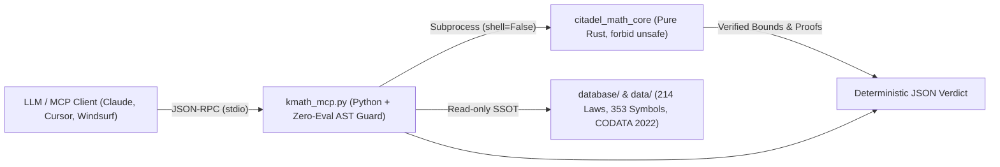

# Citadel-Math (`citadel_math_core` / `kmath-mcp`)

[](https://github.com/imza464-cmyk/citadel-math/actions/workflows/ci.yml)
[](https://github.com/imza464-cmyk/citadel-math/releases)
[](./LICENSE)
[](./citadel_math_core/src/lib.rs)
[](./kmath_mcp.py)

**$\mathbb{Z}^7$ Dimensional Analysis Shield, Checked-`i64` Algebraic Equivalence Checker, and Interval/Physics Verification Engine (Pure-Rust Core + Python/SymPy MCP Server).**  
*$\mathbb{Z}^7$ Boyut Analizi Kalkanı, Taşma Korumalı `i64` Cebirsel Eşdeğerlik Denetleyicisi ve Aralık/Fizik Doğrulama Motoru (Saf-Rust Çekirdek + Python/SymPy MCP Sunucusu).*

---

## Why Citadel-Math? / Neden Citadel-Math?

Large Language Models hallucinate units, drop denominator domain guards, confuse classical/relativistic regimes, and leak IEEE-754 rounding errors into engineering safety factors.  
**Citadel-Math (`kmath-mcp`)** pairs a **pure-Rust (`#![forbid(unsafe_code)]`) numerical and algebraic core (`citadel_math_core`)** with a **Python + SymPy Model Context Protocol server (`kmath_mcp.py`)**, giving AI coding agents (Claude, Cursor, Windsurf, Antigravity) and engineers a deterministic verification layer backed by NIST CODATA 2022 constants, SI dimensional lattice checks, outward-rounded intervals, and a canonical physics equation graph.

Büyük Dil Modelleri (LLM) formül türetirken sıklıkla birim hatası yapar, payda sıfır koşullarını atlar ve kayan nokta yuvarlama hatalarını güvenlik katsayılarına sızdırır. **Citadel-Math**, saf Rust (`#![forbid(unsafe_code)]`) ile yazılmış deterministik hesaplama çekirdeğini (`citadel_math_core`) Python/SymPy tabanlı bir MCP sunucu katmanıyla (`kmath_mcp.py`) birleştirerek yapay zekâ ajanlarına birim, aralık ve cebirsel eşdeğerlik doğrulama araçları sunar.



---

## Live Examples / Canlı Örnekler

### 1. Catching a 1000× SI Unit Scaling Error (`kmath_dimension_check`)
`kmath_dimension_check("kN", "kg * m / s^2")` recognizes that both sides share dimension $\text{M L T}^{-2}$ yet flags the `1000.0×` scale mismatch:
```json
{
  "lhs": "kN",
  "rhs": "kg * m / s^2",
  "dim_lhs": "M L T^-2",
  "dim_rhs": "M L T^-2",
  "homogeneous": true,
  "si_scale_ratio_lhs_over_rhs": 1000.0,
  "verdict": "DIMENSIONALLY_HOMOGENEOUS_BUT_UNIT_SCALE_MISMATCH"
}
```

### 2. Blocking a Domain-Guard-Dropping Simplification (`kmath_prove_identity`)
`kmath_prove_identity("(x^2 - 1) / (x - 1)", "x + 1")` rejects naive cancellation because `x = 1` is singular on the LHS:
```json
{
  "lhs_domain_guards": ["(x - 1) != 0"],
  "rhs_domain_guards": [],
  "proven_identical": false,
  "reason": "Tanım kümesi (yan koşul) eşitsizliği! Yan koşul yutan sadeleştirme reddedildi.",
  "status": "ok"
}
```

### 3. Outward-Rounded Interval Bounds + Exact Derivative (`kmath_interval_eval`)
`kmath_interval_eval("(x + 1) / y", '{"x": [1.0, 2.0], "y": [2.0, 4.0]}', "x")`:
```json
{
  "expression": "((x + 1) / y)",
  "outward_interval": [0.5, 1.5],
  "midpoint_value_and_gradient": [0.8333333333333333, {"x": 0.3333333333333333, "y": -0.2777777777777778}],
  "symbolic_derivative": "(1 / y)",
  "status": "ok"
}
```

---

## Core Architecture / Temel Mimari

```text
.
├── .github/
│   ├── ISSUE_TEMPLATE/             # Bug report & mathematical/physical soundness issue templates
│   └── workflows/
│       ├── ci.yml                  # Cross-platform CI (Linux/Windows): clippy, tests, audits & MCP security
│       └── release.yml             # Automated Linux/Windows release binary & SHA256SUMS publishing
├── AGENTS.md                       # Engineering invariants (dimensional homogeneity & SSOT rules)
├── CHANGELOG.md                    # Versioned release history (Keep a Changelog)
├── HATA_KAYIT_DEFTERI.md           # Engineering bug & regression logbook
├── SECURITY.md                     # Threat model, zero-eval parser policy & vulnerability disclosure
├── kmath.py                        # Verification cockpit CLI (10 Python SSOT + 16 Rust audit gates)
├── kmath_mcp.py                    # 15-Tool Model Context Protocol (MCP) Server (zero-eval AST input parser)
├── mcp_config.example.json         # Portable MCP client configuration example
├── tests/
│   └── test_mcp_security.py        # Zero-eval RCE rejection & live Python-to-Rust MCP integration tests
├── citadel_math_core/              # Pure-Rust (#![forbid(unsafe_code)]) Engine & Native Binary
│   └── src/
│       ├── proof_kernel.rs         # Z[x] & MultiPolyZ (grevlex) algebraic equivalence + GuardedPoly guards
│       ├── interval.rs             # IEEE 1788-2015 outward-rounded Interval64 + Dual64 differentiation
│       ├── dimensions.rs           # Z^7 SI Dimensional Shield & ScaledUnit converter
│       ├── buckingham.rs           # Exact rational/integer Z^7 nullspace Buckingham-Pi discovery
│       ├── pareto.rs               # Exact Skyline & NSGA-II multi-objective Pareto optimizer
│       ├── graph.rs                # SSOT canonical hypergraph (214 laws, 544 inverse laws, 18 regimes)
│       ├── simulator.rs            # RK4 & adaptive Dormand-Prince RK4(5) integrator + USSA-1976 model
│       ├── astrodynamics.rs        # WGS84 J2 orbital precession & universal-variable Lambert solver
│       ├── materials.rs            # 30 aerospace/UHTC/TPS materials, NASA SP-8007 buckling & TPS checks
│       ├── cad.rs                  # 2D parametric CAD, Steiner/moment of inertia, Euler buckling & DXF/SVG
│       ├── designer.rs             # Closed-loop parametric preliminary sizing engine
│       ├── codegen.rs              # Verified zero-panic Result<f64, &'static str> Rust function generator
│       └── physical_bounds.rs      # Thermodynamics 1st/2nd law (Carnot), v < c causality & momentum pruning
├── engine/                         # Python symbolic AST, SymPy parity, harvester, RK4 & knowledge graph
├── database/
│   ├── canonical_laws.json         # 214 verified laws across 25+ domains (physics, aerospace, real-time, biomechanics)
│   ├── ONTOLOGY.json               # 353 unique SI symbol-dimension definitions (SSOT)
│   └── materials.json              # 30 certified structural & thermal protection materials
└── data/
    └── nist_constants.json         # NIST CODATA 2022 fundamental constants
```

---

## Quick Start / Hızlı Kurulum

### 1. Run Unit Tests & Build Rust Core / Birim Testleri ve Rust Derlemesi
```bash
cargo test --manifest-path citadel_math_core/Cargo.toml
cargo build --release --manifest-path citadel_math_core/Cargo.toml
```

### 2. Install Python Dependencies / Python Bağımlılıklarını Yükleyin
```bash
pip install -r requirements.txt
```

### 3. Verify All 26 Audit Gates & MCP Security Suite / Denetim Kapıları ve Güvenlik Testleri
```bash
python kmath.py audit
python kmath.py rust audit
python -m unittest discover -s tests -v
```

### 4. Connect as an MCP Server / MCP Sunucusu Olarak Bağlayın
Copy `mcp_config.example.json` into your MCP client configuration and replace `/ABSOLUTE/PATH/TO/citadel-math/kmath_mcp.py` with your absolute local path:
```json
{
  "mcpServers": {
    "kmath": {
      "command": "python",
      "args": ["/ABSOLUTE/PATH/TO/citadel-math/kmath_mcp.py"],
      "env": {
        "OPENBLAS_NUM_THREADS": "1",
        "PYTHONUNBUFFERED": "1"
      }
    }
  }
}
```

---

## 15 Deterministic MCP Tools (`kmath_mcp.py`)

| Tool | Function |
| :--- | :--- |
| `kmath_audit` | Runs the Python (10-gate) & Rust (16-gate) engineering verification audits. |
| `kmath_dimension_check` | Verifies $\mathbb{Z}^7$ SI dimensional homogeneity (`dim(LHS) == dim(RHS)`) for expressions. |
| `kmath_prove_identity` | Proves polynomial/rational algebraic equivalence (`GuardedPoly`) with domain guards & overflow rejection. |
| `kmath_interval_eval` | Evaluates expressions using IEEE 1788-2015 outward-rounded `Interval64` + `Dual64` sensitivity. |
| `kmath_constant` | Fetches NIST CODATA 2022 fundamental constants and exact SI definitions. |
| `kmath_materials` | Queries and ranks 30 structural, cryogenic, UHTC, and ablative TPS materials. |
| `kmath_stress_check` | Checks cylindrical shell Von Mises stress, NASA SP-8007 buckling, and aerothermal TPS limits. |
| `kmath_simulate_trajectory` | Runs 4th-order Runge-Kutta (RK4) trajectory integration with USSA-1976 7-layer atmosphere. |
| `kmath_solve_for` | Symbolically solves canonical equations with automated SymPy/AST validation. |
| `kmath_synthesize` | Synthesizes valid candidate equations across the canonical AND-OR hypergraph with regime pruning. |
| `kmath_inverse_design` | Runs closed-loop parametric sweeps returning Pareto-filtered preliminary aerospace configurations. |
| `kmath_physical_bounds_check` | Prunes violations of 1st/2nd Thermodynamics Laws (Carnot), $v < c$, and momentum conservation. |
| `kmath_regime_check` | Validates variable compatibility across 18 physical validity regimes (`Mach`, relativistic, etc.). |
| `kmath_buckingham_pi` | Computes exact integer $\mathbb{Z}^7$ nullspace dimensionless $\Pi$-groups. |
| `kmath_pareto_front` | Computes exact Pareto Skyline (`Rank 0`), NSGA-II crowding distances, and Utopia knee points. |

---

## CLI Usage / Komut Satırı Kullanımı

```bash
python kmath.py audit                 # Run 10-gate Python + SSOT engineering audit
python kmath.py rust audit            # Run 16-gate pure-Rust proof & simulation audit
python kmath.py simulate compare      # Compare Chemical vs. Beamed Laser vs. Kinetic launch trajectories
python kmath.py materials             # Rank aerospace/TPS materials by breaking length & strength
python kmath.py stress                # Check cylindrical shell stress & heat flux limits
python kmath.py stats                 # Show ontology & canonical law metrics
```

---

## Scope & Known Limitations / Kapsam ve Bilinen Sınırlar

- **Positioning / Amaç:** Citadel-Math is a deterministic MCP helper layer designed to catch unit, domain, and rounding errors in LLM-assisted workflows. It does **not** claim to replace battle-tested scientific ecosystems (`SymPy`, `SciPy`, `nalgebra`, `uom`, `GMAT`) or certified FEA/CFD suites for safety-critical production sign-off.
- **Algebraic Equivalence Checker (`PolyZ` / `MultiPolyZ`):** Checks polynomial and guarded rational equivalence under overflow-checked `i64` arithmetic (`GuardedPoly`); it is not a general theorem prover like Lean/Coq or an arbitrary-precision Gröbner basis solver over $\mathbb{C}$.
- **Astrodynamics & Trajectory (`RK4` / `RK4(5)`):** Models 2D point-mass trajectories, 7-layer USSA-1976 hydrostatic atmosphere, and secular WGS84 $J_2$ drift / two-body Lambert transfer; it does not model 6-DoF rigid-body aerodynamics or full $N$-body JPL ephemerides.
- **Structural & Thermal Sizing (`NASA SP-8007` & `Sutton-Graves`):** Cylindrical shell stress and ablative TPS margins provide Phase-A conceptual pre-sizing filters, not flight-certification 3D finite-element analysis.

---

## Reference Validation / Dış Referans Karşılaştırması

| Benchmark / Standard | Reference Value | Citadel-Math Check | Tolerance / Result |
| :--- | :--- | :--- | :--- |
| **NIST CODATA 2022** ($\mu_0 \varepsilon_0 c^2$) | `1.0` (Maxwell vacuum identity) | `constants.rs` / `kmath.py` | Relative drift `< 2e-10` (PASS) |
| **USSA-1976 Atmosphere** (0 / 11 / 47 km) | `288.15 K` / `216.65 K` / `270.65 K` | `AtmosphereModel::state_at` | `< 1e-3 K`, sea-level `a0 = 340.294 m/s` (PASS) |
| **WGS84 $J_2$ Critical Inclination** | `63.4349488°` ($\dot{\omega} = 0$) | `J2OrbitalModel::perigee_precession_rate_rad_s` | `|dω/dt| < 1e-16 rad/s` (PASS) |
| **WGS84 ISS LEO RAAN Drift** ($400\text{ km}, 51.64^\circ$) | `~ -4.998°/day` (NASA/NORAD) | `J2OrbitalModel::raan_precession_rate_rad_s` | `-4.9979°/day` (PASS) |
| **Lambert Orbital Transfer** (90° LEO) | Vis-viva energy & $\mathbf{h}$ conservation | `LambertSolver::solve` | Relative energy drift `< 1e-9` (PASS) |
| **IEEE 1788-2015 `Interval64`** (`1/3 * 3`) | Exact inclusion `1.0 ∈ [lo, hi]` | `Interval64::div` / `mul` | `0/1-ULP` outward rounding, `0 ∈ denom` rejected (PASS) |
| **Native Rust Audit Latency** (16 gates) | Sub-20 ms local execution | `citadel_math_core audit` | `~13–17 ms` release build |

---

## Verification Summary / Doğrulama Özeti

- **Rust Lint & Unit Tests (`cargo clippy` + `cargo test`):** `0` clippy warnings (`-D warnings`) and `33 passed; 0 failed` (`24` in `proof_kernel`, `4` in `cad`, `5` cross-module tests in `lib.rs`).
- **MCP Security & Integration Tests (`unittest`):** Zero-`eval` AST parser rejects `__import__`, attribute traversal, and `lambda` injection payloads (`0` calls to `sympy.sympify()`), and verifies live Python-to-Rust MCP tool bridges.
- **Python Audit (`python kmath.py audit`):** `10/10 PASS` (`214` canonical laws, `353` ontology symbols, `18` physical regimes, `30` materials).
- **Rust Audit (`python kmath.py rust audit`):** `16/16 PASS` (`#![forbid(unsafe_code)]`, `214` SSOT AST laws + `544` inverse laws, IEEE 1788-2015 outward-rounded intervals, Buckingham-$\Pi$, NSGA-II Skyline, 2D CAD R12 DXF/SVG).

---

## License / Lisans

**Citadel-Math Source-Available License (Read & Run Permitted — All Modification & Derivative Rights Reserved).**  
*İnceleme, derleme ve olduğu gibi çalıştırma serbesttir; kaynak kodunu değiştirme, türev eser üretme ve değiştirilmiş sürüm dağıtma haklarının tamamı saklıdır (Tüm Değiştirme Hakları Saklıdır).* — see [LICENSE](./LICENSE) for details.  
Copyright © 2026 Mekserina Karaosmanoğlu. All Modification Rights Reserved.
